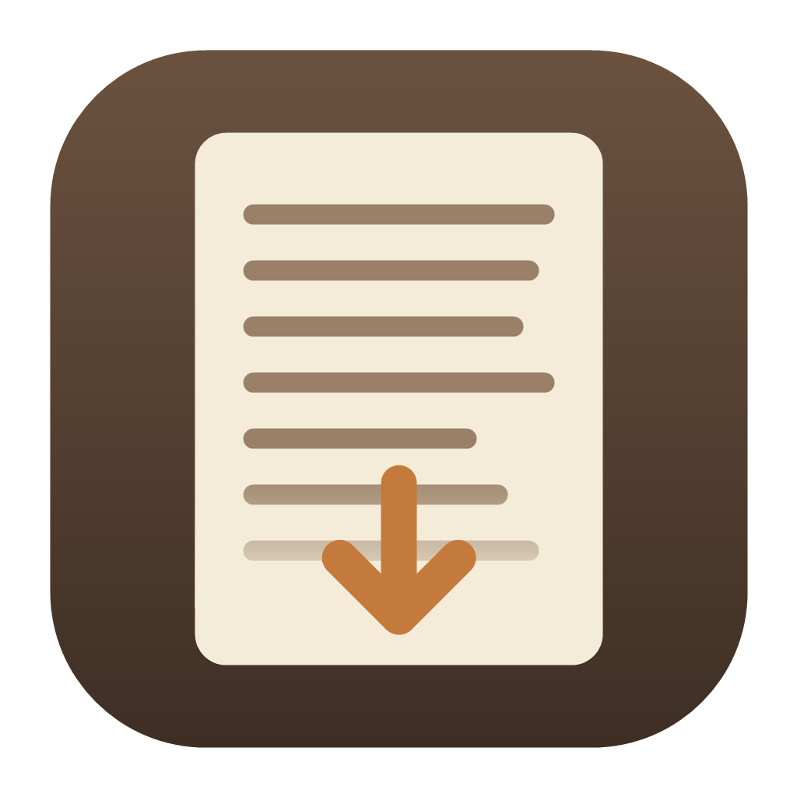
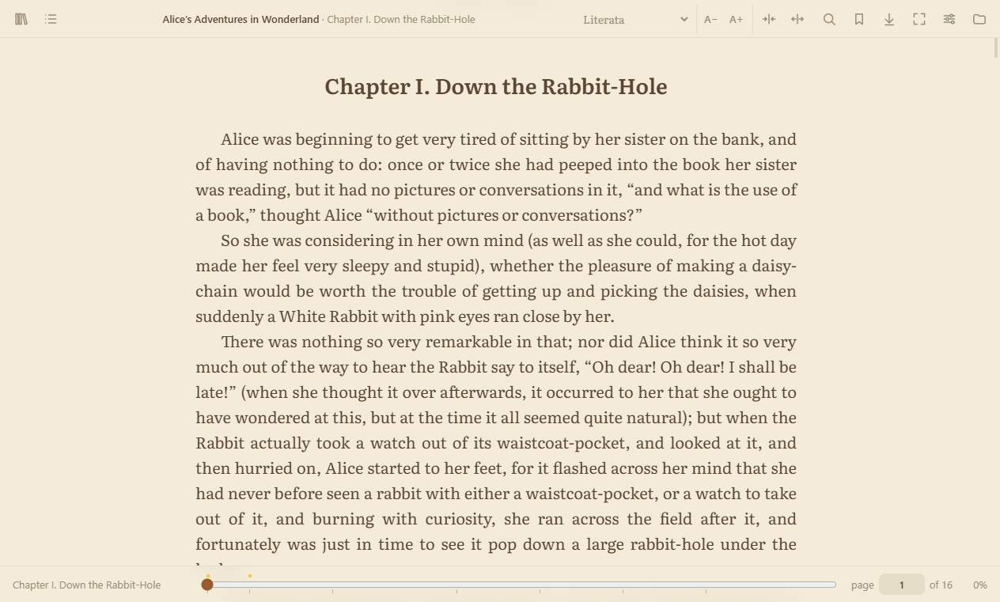
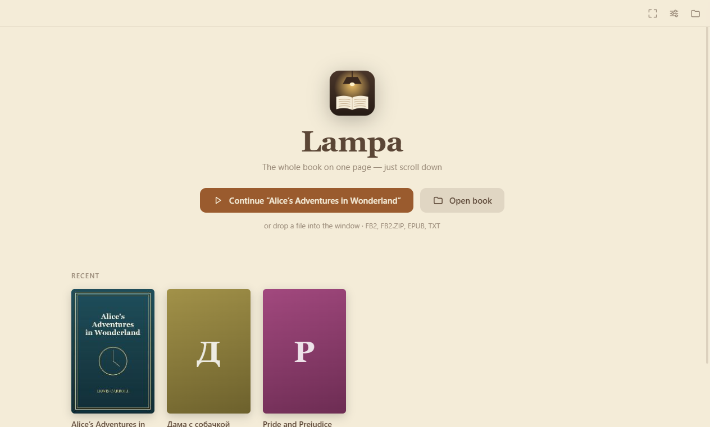
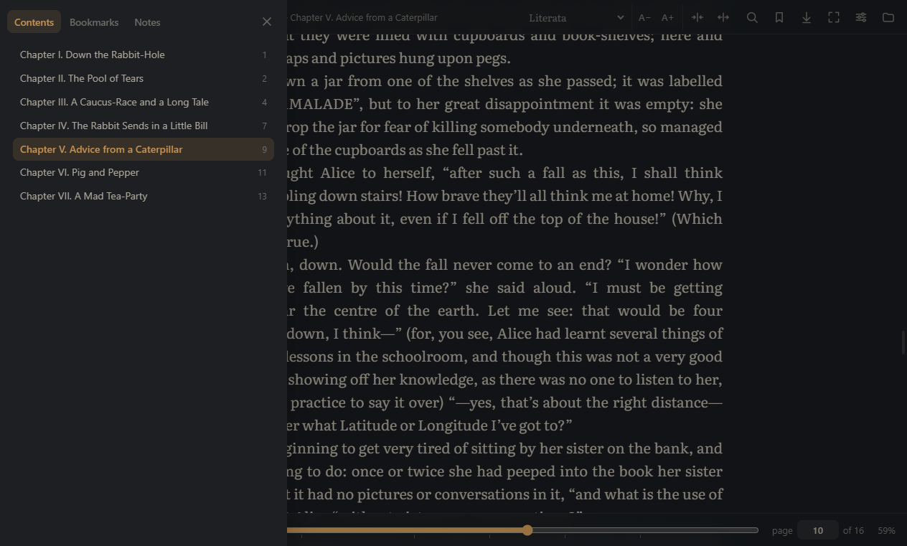
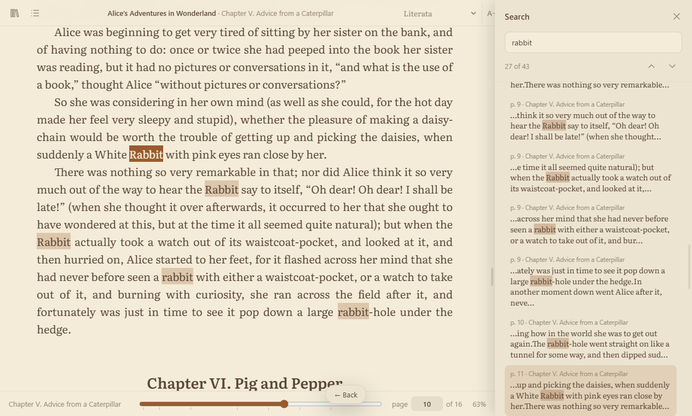
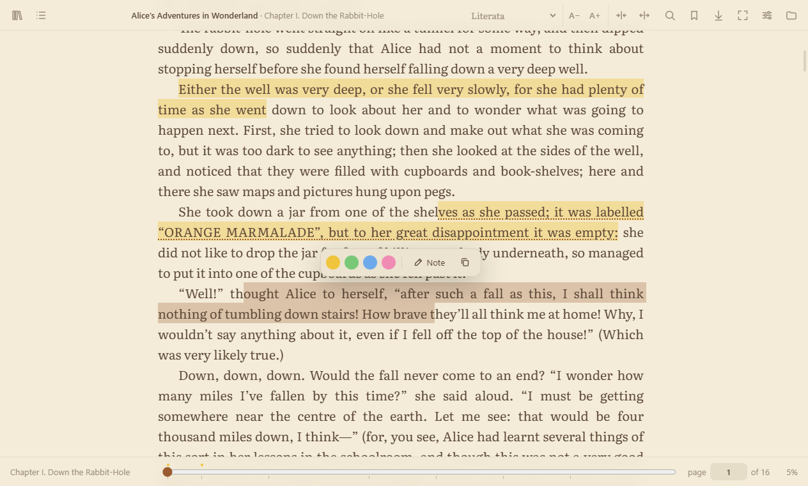
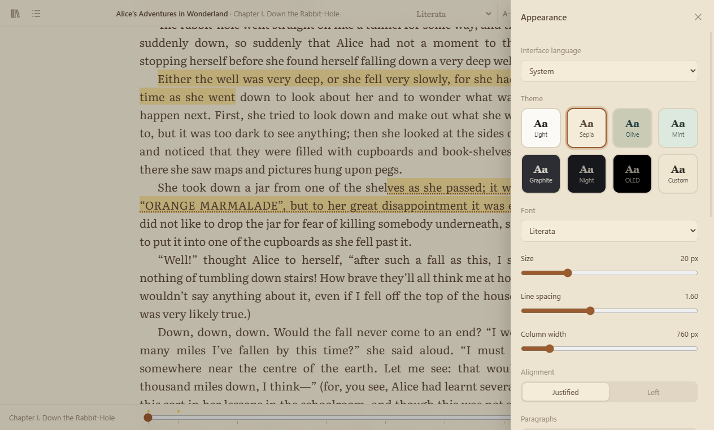

<p align="center">
  
</p>

<h1 align="center">Lampa</h1>

<p align="center">
  A calm, cross-platform book reader. The whole book is one continuous page: just scroll.<br>
  FB2 · EPUB · TXT · Windows · macOS · Linux
</p>

<p align="center">
  <a href="https://github.com/Zelinsky-Vladimir/lampa-releases/releases/latest"></a>
  <a href="https://github.com/Zelinsky-Vladimir/lampa-releases/releases"></a>
  <a href="LICENSE"></a>
</p>

<p align="center">
  <a href="https://lampa-reader.github.io">lampa-reader.github.io</a>
</p>

<p align="center">
  <b>English</b> · <a href="README.ru.md">Русский</a>
</p>

<p align="center">
  
</p>

## Download

| System | File | Notes |
| --- | --- | --- |
| **Windows** 10 / 11 | [**Lampa-Setup.exe**](https://github.com/Zelinsky-Vladimir/lampa-releases/releases/latest/download/Lampa-Setup.exe) | Installer. Adds Start menu and desktop shortcuts, opens `.fb2` / `.epub`, and updates itself. |
| Windows, no install | [Lampa-Portable.exe](https://github.com/Zelinsky-Vladimir/lampa-releases/releases/latest/download/Lampa-Portable.exe) | Runs from any folder or USB stick. Doesn't update itself. |
| **macOS**, Apple Silicon (M1–M4) | [Lampa-mac-arm64.dmg](https://github.com/Zelinsky-Vladimir/lampa-releases/releases/latest/download/Lampa-mac-arm64.dmg) | See [macOS notes](#macos). |
| macOS, Intel | [Lampa-mac-x64.dmg](https://github.com/Zelinsky-Vladimir/lampa-releases/releases/latest/download/Lampa-mac-x64.dmg) | |
| **Linux**, any distro | [Lampa-linux-x86_64.AppImage](https://github.com/Zelinsky-Vladimir/lampa-releases/releases/latest/download/Lampa-linux-x86_64.AppImage) | Single file that updates itself. |
| Linux, Debian / Ubuntu | [Lampa-linux-amd64.deb](https://github.com/Zelinsky-Vladimir/lampa-releases/releases/latest/download/Lampa-linux-amd64.deb) | |

All versions and change notes are on the [Releases](https://github.com/Zelinsky-Vladimir/lampa-releases/releases) page.

## Features

- **Scroll or pages.** Read the book as one continuous page, or switch to pages (`P`) and turn them with the arrow keys, the mouse wheel or a click on the page edge. Pages turn with a paper-like curl by default, or slide, fade, flip, or have no animation, and a wide screen can show two pages side by side. In pages mode page numbers follow the pages on screen. Lampa remembers exactly where you stopped in either mode.
- **Your own library.** Every book you open is copied into Lampa's library, so it stays there even if you delete or move the original file. Removing a book from the library deletes only that copy.
- **Sync between devices.** Sign in with Google or with an email and password (Settings → Sync), and your library, reading position, bookmarks, notes and book lists follow you between computers and phones. A book added on one device appears on the others and downloads when you open it there; if you read further elsewhere while a book is open, Lampa offers to jump there.
- **Read and Want to read.** Keep lists of the books you have read, in Lampa or anywhere else, and the books you plan to read. One search field filters your list and finds new books online at the same time, by title, author or ISBN, with covers; add a found book in one click. Rate read books from 1 to 10 stars, add the date you finished and notes, and compare your rating with the average reader rating from Open Library or Apple Books, on the same 10-point scale (for translated books Lampa also looks up the original edition via Wikidata, since it has far more ratings). Order Want to read by dragging the books and filter it by genre. Books not found online can be added by hand.
- **Real page numbers.** A page is 1,800 characters, like a printed book, so "page 124" stays the same when you change the font or resize the window. Jump to any page by typing its number.
- **Progress bar** with chapter marks, bookmarks and notes; drag it to jump anywhere and see the page and chapter as you go.
- **Search** across the whole book, with every match listed by page and chapter and highlighted in the text.
- **Bookmarks, highlights and notes.** Select text to highlight it in one of four colours or attach a note; all of them are listed in the side panel and can be copied out as Markdown.
- **Themes:** Paper (default), Sepia, Sage, Dusk, Night (true black for OLED), or your own: pick the background and text colours separately, with a contrast hint.
- **In-app brightness** from 30% to 100%, one click away in the top bar (☀), independent of your monitor.
- **21 fonts,** including 14 built-in reading fonts with full Cyrillic support (Literata, PT Serif, Merriweather, Lora, EB Garamond, Inter and more) that look the same on every system.
- **Zoom that uses the space.** `Ctrl` `+` / `−` (or `Ctrl` + mouse wheel) scales the font and the column together, so text fills a wide monitor instead of sitting in a narrow strip. The column width can also be changed on its own.
- **Auto-scroll** with a speed control right on screen.
- **Translate any selection** with Google Translate: the word or phrase, dictionary variants for single words, and the whole surrounding sentence, so you can see which meaning is meant here. Save it as a note in one click.
- **Footnotes** pop up in place, so you don't lose your spot.
- **Any encoding.** Old Russian and Ukrainian books in windows-1251, KOI8 or CP866 open without garbled text.
- **Interface in five languages:** English, Русский, Français, Deutsch, Español.
- **Private.** Without signing in, books never leave your computer. If you turn on sync, your books (up to 50 MB each), reading positions, notes and lists are stored in your private account on [Supabase](https://supabase.com) servers in Frankfurt, visible only to you. Lampa otherwise goes online only to check for updates on GitHub and, when you press Translate, to send the selected text and its sentence to Google Translate. Searching for a book to add to your lists sends the search text to Apple Books and Open Library, which also supply the covers, and book titles to Wikidata to find the original edition.

## Screenshots

| | |
| --- | --- |
|  |  |
| **Library:** recent books with covers and progress | **Night theme** with contents and page numbers |
|  |  |
| **Search:** every match with its page and chapter | **Highlights and notes** on selected text |
|  | |
| **Appearance:** language, themes, fonts, layout | |

## Supported formats

| Format | What works |
| --- | --- |
| **FB2**, **FB2.ZIP** | Text, cover, annotation, images, footnotes, poems, epigraphs, tables |
| **EPUB** 2 / 3 | Chapters, cover, images, internal links, footnotes (`epub:type="noteref"`) |
| **TXT** | Automatic encoding detection, paragraphs, chapter headings in six languages |

## Installation

### Windows

1. Download **Lampa-Setup.exe** and run it.
2. If SmartScreen says *"Windows protected your PC"*, click **More info → Run anyway**. The app isn't signed with a paid certificate; the code is all here and the builds come from [GitHub Actions](https://github.com/Zelinsky-Vladimir/lampa/actions).
3. Lampa appears in the Start menu and on the desktop. Double-clicking a `.fb2` or `.epub` file opens it in Lampa.

To try it without installing, use **Lampa-Portable.exe**.

### macOS

1. Download the `.dmg` for your Mac: **arm64** for Apple Silicon (M1–M4), **x64** for Intel. You can check under  → About This Mac.
2. Open it and drag **Lampa** into **Applications**.
3. The first time, **right-click Lampa → Open → Open**. The app isn't notarised by Apple, so a normal double-click is blocked once.
4. If macOS says *"Lampa is damaged and can't be opened"*, run this once in Terminal:
   ```bash
   xattr -cr /Applications/Lampa.app
   ```

### Linux

**AppImage (any distro):**

```bash
chmod +x Lampa-linux-x86_64.AppImage
./Lampa-linux-x86_64.AppImage
```

**Debian / Ubuntu:**

```bash
sudo apt install ./Lampa-linux-amd64.deb
```

### iPhone and iPad (early version)

The iOS app isn't in the App Store yet; you build it yourself on a Mac with [Xcode](https://apps.apple.com/app/xcode/id497799835) and [Node.js](https://nodejs.org).

```bash
git clone https://github.com/Zelinsky-Vladimir/lampa.git
cd lampa
npm ci
npm run ios
```

`npm run ios` builds the app and opens it in Xcode. Then:

1. Select the **App** project → **App** target → **Signing & Capabilities**, and pick your Apple ID under **Team** (**Add Account…** if it isn't there).
2. Connect the iPhone, turn on **Developer Mode** on it (Settings → Privacy & Security), and choose it at the top of the Xcode window.
3. Press **Run** (▶). The first time, allow the developer on the iPhone: Settings → General → VPN & Device Management.

With a free Apple ID the app runs for 7 days, after which you press **Run** again (your books and notes stay). A paid Apple Developer account extends this to a year and allows TestFlight.

On the phone, books open from the Files app, or from Telegram, Mail and others with **Share → Lampa**. Pages turn with a swipe or a tap on the page edge; a tap in the middle shows the panels.

To update: `git pull && npm ci && npm run ios`, then **Run**.

## Updates

The installed Windows app and the Linux AppImage check [Releases](https://github.com/Zelinsky-Vladimir/lampa-releases/releases) on start. A new version downloads in the background; click **Restart** in the banner, or it installs the next time you close Lampa. The portable `.exe`, the `.deb` and the macOS build don't update themselves, so download them again to update.

## Keyboard shortcuts

| Keys | Action |
| --- | --- |
| `Space` / `PgDn`, `Shift+Space` / `PgUp` | Page down / up |
| `←` / `→`, click on the page edge | Previous / next page (pages mode) |
| `P` | Switch between scroll and pages |
| `↑` `↓`, `Home` / `End` | Scroll a few lines; go to the start / end |
| `Ctrl+F`, `Enter` / `F3` | Search; next match (`Shift` for previous) |
| `Ctrl+G` | Go to page |
| `T` | Contents, bookmarks and notes |
| `B` | Bookmark the current page |
| `S` | Appearance |
| `A`, `[` `]` | Auto-scroll; slower / faster |
| `Ctrl` `+` / `−` / `0`, `Ctrl` + wheel | Zoom (font and column together); reset |
| `Ctrl+Shift+←` / `→` | Narrower / wider column |
| `Ctrl+O` | Open a book |
| `F11` | Full screen |
| `Esc` | Close a panel, pop-up or search |

## Building from source

You need [Node.js](https://nodejs.org) 20 or newer.

```bash
git clone https://github.com/Zelinsky-Vladimir/lampa.git
cd lampa
npm install
npm start
```

To open a specific book: `npm start -- path/to/book.fb2`.

To build installers for your current system (output goes to `dist/`):

```bash
npm run dist
```

**Releasing.** Bump `version` in `package.json`, commit, then push a tag. [GitHub Actions](.github/workflows/build.yml) builds Windows, macOS and Linux and publishes a release, and installed copies pick it up automatically.

```bash
git tag v1.2.3
git push origin v1.2.3
```

### Project layout

```
main.js             Electron main process: window, file dialogs, reading and unzipping books, updates
preload.js          the narrow bridge between the window and the main process
src/app.js          the reader: scrolling, pages, search, bookmarks, notes, settings
src/parsers.js      FB2 / EPUB / TXT → safe DOM
src/decode.js       text encoding detection
src/i18n.js         interface translations
src/online.js       book search, reader ratings, genres and translation (shared by desktop and mobile)
src/fonts/          built-in fonts (regenerate with npm run fonts)
mobile/             the iOS version's platform layer (files, network, covers) and phone styles
ios/                the Xcode project (Capacitor); npm run build:mobile assembles www/ for it
```

Book content is never inserted as HTML. Every element is rebuilt from an allow-list, so scripts, iframes and event handlers inside an EPUB can't run. The window runs sandboxed with a strict Content Security Policy.

### Adding a language

Copy the `en` block in [`src/i18n.js`](src/i18n.js), translate the strings, and add the language to `LANGS`. Any key you leave out falls back to English.

## License

[MIT](LICENSE). The built-in fonts are under the SIL Open Font License; their licenses are in [`src/fonts/licenses`](src/fonts/licenses). The sample books in the screenshots are in the public domain.
